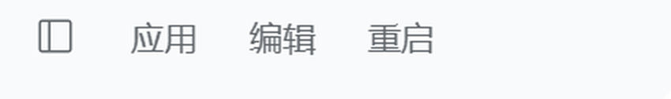

# dsh-titlebar-restart

[中文](README.md) | English

> Windows Desktop only. Adds a 重启 item to the DSH window caption menubar next to
> 应用 and 编辑; the second click stops the app and starts the same executable again
> through a WMI-spawned PowerShell helper.

Category: **Development & Runtime (`dev`)** · Install: `dsh plugin --profile <profile> add dsh-titlebar-restart`



## What it does

The Desktop caption menubar is drawn by Electron's preload, not by a Web slot, so
this plugin does two things:

- **Host half** — registers one authenticated route, `POST /api/titlebar-restart`,
  on the Connection channel (`ctx.connection.fetch`), so the Connection plugin's
  Host/Origin fence and browser-session cookie apply before the handler runs.
- **Browser half** — waits for the preload's `[data-windows-menu]` shadow host and
  appends one `<button role="menuitem">` into its `[role=menubar]`. The button is
  styled by the preload's own `button { ... }` rule, which is why it matches
  **编辑** exactly instead of approximating it.

Click once and the label becomes **确认重启**; click again within four seconds and
it becomes **重启中…**. That second click is what POSTs the route.

## Restart mechanics

The Host writes a small PowerShell script and asks WMI (`Win32_Process.Create`) to
run it. The helper is therefore parented by `WmiPrvSE`, not by the process tree it
is about to stop, so it survives long enough to:

1. wait ~0.9 s for the HTTP response to reach the browser,
2. stop the Electron main process and the Host,
3. wait for the listening port to be released,
4. start the same executable again.

Total round trip is roughly 3–4 seconds. The log and the generated scripts live in
`%TEMP%\dsh-titlebar-restart\` (`restart.log`, `restart.ps1`, `launch.ps1`) — if a
restart ever fails, `restart.ps1` can be run by hand.

Nothing under `Program Files` is modified: the plugin is an ordinary profile
plugin, so a Desktop update does not remove it.

## Requirements

- **DSH Desktop on Windows.** The caption menubar is a Windows-Desktop surface; a
  plain `dsh web` server has no window and no menubar, so the route answers
  `409 not-desktop` and the browser half stays inert. macOS and Linux are not
  supported.
- Node 22+ (the Desktop runtime always is).

## Install

From the plugin market (Plugins → Discover), or:

```sh
dsh plugin --profile <profile> add dsh-titlebar-restart
```

Before the package is on npm, install straight from the repository (requires git):

```sh
dsh plugin --profile <profile> add github:NyaNyaHua4290/dsh-titlebar-restart
```

Then restart DSH once so the bundle mounts.

## Safety

- The route is only reachable with the Web UI's session cookie; an unauthenticated
  request is rejected by the Connection layer before this plugin sees it.
- It refuses to act unless the Host's parent is the Electron Desktop shell — under
  `dsh web` it will not kill the terminal it was started from.
- **Clicking restart interrupts whatever is running**, including the current
  conversation turn. Sessions are persisted and reopen after the relaunch.

## Uninstall

Remove the plugin from the profile (market → Uninstall, or `dsh plugin remove`).
The generated helper scripts stay in `%TEMP%\dsh-titlebar-restart\` and can simply
be deleted.

## License

MIT
