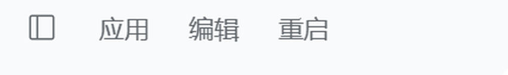

# dsh-titlebar-restart

中文 | [English](README.en.md)

> 仅 Windows 桌面版。在 DSH 窗口标题栏菜单（应用 / 编辑）后加一个「重启」项，连点两次即由
> WMI 拉起的 PowerShell 脚本结束应用并重新启动同一个可执行文件。

分类：**开发与运行时（`dev`）** · 安装：`dsh plugin --profile <profile> add dsh-titlebar-restart`



## 它做什么

标题栏菜单由 Electron 的 preload 绘制，不在 Web 插槽体系里，所以插件有两半：

- **宿主半**：在 Connection 通道注册一条带 Cookie 鉴权的路由
  `POST /api/titlebar-restart`（走 `ctx.connection.fetch`）。Connection 插件会先做
  Host/Origin 校验与会话 Cookie 校验，未通过者根本到不了本插件。
- **浏览器半**：等 preload 挂出 `[data-windows-menu]` 这个开放 shadow root，往它的
  `[role=menubar]` 里追加一个 `<button role="menuitem">`。样式直接继承 preload 自带的
  `button { ... }` 规则，所以和 **编辑** 完全一致，而不是「看起来差不多」。

点一下变成 **确认重启**，四秒内再点一下变成 **重启中…**，这一下才真正 POST。

## 重启是怎么执行的

宿主先写出一小段 PowerShell，再用 WMI（`Win32_Process.Create`）拉起它。脚本的父进程
因此是 `WmiPrvSE` 而不是即将被结束的进程树，于是它能活到把活儿干完：

1. 等约 0.9 秒，让 HTTP 响应先回到浏览器；
2. 结束 Electron 主进程与本 Host；
3. 等监听端口释放；
4. 重新启动同一个可执行文件。

整体约 3~4 秒。日志与生成的脚本在 `%TEMP%\dsh-titlebar-restart\`（`restart.log`、
`restart.ps1`、`launch.ps1`）——万一哪次重启没回来，可以直接手动跑 `restart.ps1`。

`Program Files` 下的任何文件都没有被改动：这就是一个普通的 profile 插件，桌面版升级
不会把它覆盖掉。

## 环境要求

- **Windows 上的 DSH 桌面版。** 标题栏菜单是桌面窗口才有的东西；用 `dsh web` 起的
  服务没有窗口也没有菜单行，路由会返回 `409 not-desktop`，浏览器半保持静默。macOS 与
  Linux 不支持。
- Node 22+（桌面版运行时本来就满足）。

## 安装

在插件市场里（插件 → 发现）安装，或者：

```sh
dsh plugin --profile <profile> add dsh-titlebar-restart
```

没发 npm 包时，也可以直接从仓库装（需要本机有 git）：

```sh
dsh plugin --profile <profile> add github:NyaNyaHua4290/dsh-titlebar-restart
```

装完重启一次 DSH，让 bundle 挂载。

## 安全说明

- 路由只对持有 Web UI 会话 Cookie 的请求开放，未鉴权的请求在 Connection 层就被拒，
  不会到达本插件。
- 只有当 Host 的父进程是 Electron 桌面壳时才动作——用 `dsh web` 启动时它不会去结束
  你的终端。
- **点重启会中断正在运行的一切**，包括当前这一轮对话。会话会落盘，重启后自动恢复。

## 卸载

从 profile 里移除插件（市场 → 卸载，或 `dsh plugin remove`）。生成的脚本留在
`%TEMP%\dsh-titlebar-restart\`，直接删掉即可。

## 许可证

MIT
